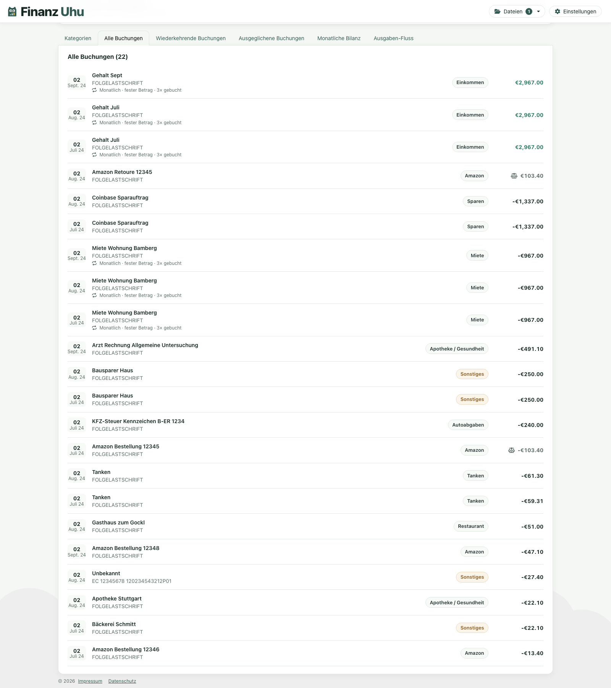

# Finance Uhu

The privacy-friendly tool to analyze your financial files on your computer.

Try out the [Demo](https://xremix.github.io/finance-uhu/) with the [Demo CSV](https://raw.githubusercontent.com/xremix/finance-uhu/main/demo.csv) and see the functionality of the App.

## Screenshots

### Startseite

### Demo-Datei mit ausgewählter Kategorie „Essen & Trinken“

### Alle Buchungen

## Getting Started

To run you need to have npm, and the ng-cli installed.

- `npm install`
- `ng serve`

## Deploy

The following task is currently being used to deploy the app

- `ng build`

The GitHub Pages workflow injects the public legal contact details at deploy time. Configure these repository Actions secrets before deploying:

- `LEGAL_NAME`
- `LEGAL_STREET`
- `LEGAL_POSTAL_CODE`
- `LEGAL_CITY`
- `LEGAL_COUNTRY`
- `LEGAL_EMAIL`

The values are not committed to the repository, but they are included in the deployed legal pages and are publicly visible there.
